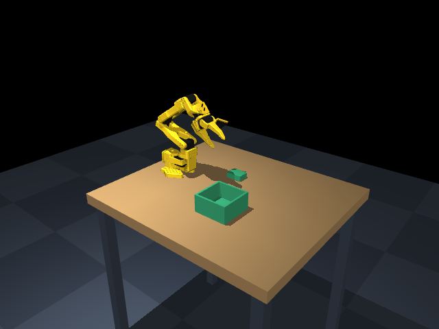
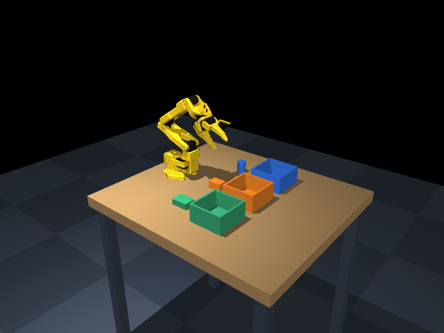
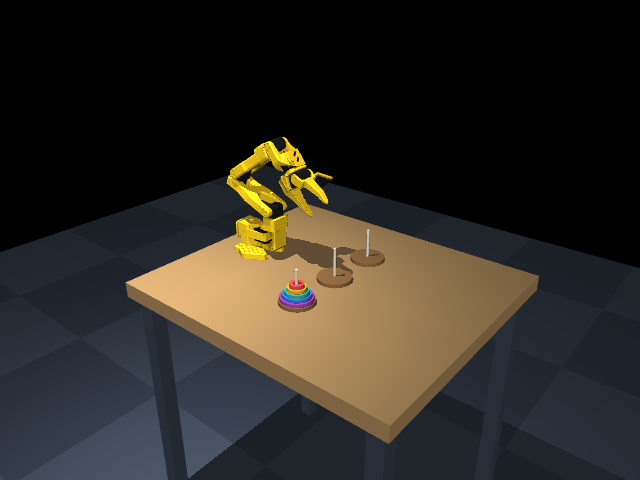

# SO-101 manipulation workbench

The supported workbench baseline is MuJoCo 3.12 or later; qualification used 3.12.0. Three table scenes use the pinned Menagerie SO-101, with its base at the table's near edge, six position actuators, an overhead camera and the original wrist camera. A separate overview camera is for the operator. The generated NERV world descriptor supplies a folded starting pose, so the wrist camera sees the work area on startup and reset.

| NERV world | Initial objects | Goal |
|---|---|---|
| `so101-pick-place` | One compliant green packet and one open basket | Place the whole object inside the basket and release it |
| `so101-sort-snacks` | Compliant packet, rigid cookie carton and rigid drink can; three colored baskets | Match green, orange and blue objects to their baskets |
| `so101-hanoi-five` | Five free annular disks on one of three pegs | Move the stack to the opposite peg, one top disk at a time, with larger disks below smaller disks |

| One object | Three snacks | Five-disk Hanoi |
|---|---|---|
|  |  |  |

These images show settled initial states. The scenes provide physics and measurements; a trained controller that completes the tasks is a separate component. Five-disk Hanoi needs at least 31 legal symbolic moves. The included symbolic planner does not execute the arm.

## Generate and replace objects

From the NERV checkout, using its simulation environment:

```bash
.venv/bin/python worlds/tools/make_workbench.py --all
.venv/bin/python worlds/tools/check_workbench.py
```

The generator writes the MJCF and metadata to `worlds/build/`, and updates the corresponding `world.yaml` and task guidance. Change the source [config.json](config.json) and [objects.json](objects.json), then regenerate. Generated XML and registry descriptors should not be edited by hand.

Replace the single task's `snack` slot with a cloth sheet:

```bash
.venv/bin/python worlds/tools/make_workbench.py --preset pick-place --object snack=cloth
```

This updates the next startup of that preset. End its current simulation instance before creating another one; changing files does not replace objects in a running model. Restore the standard presets with `--all`.

The sorting scene has the slots `chips`, `cookies` and `drink`. For example:

```bash
.venv/bin/python worlds/tools/make_workbench.py --preset sort-snacks --object chips=snack_rigid --object cookies=cloth
```

Available catalogue IDs:

| ID | Physics | Initial size, metres |
|---|---|---|
| `soft_snack` | Native 3D elastic flex, 60 moving vertices | 0.050 × 0.036 × 0.018 |
| `cloth` | Native 2D elastic flex, 42 moving vertices, self-contact enabled | 0.065 × 0.055 × 0.001 |
| `cookie_box` | Free rigid box | 0.044 × 0.030 × 0.024 |
| `drink_can` | Free rigid cylinder | Diameter 0.028, height 0.040 |
| `snack_rigid` | Rigid box with the packet's nominal dimensions and mass | 0.050 × 0.036 × 0.018 |

Flexible objects have internal degrees of freedom, elasticity, damping and physical contact. They are not rigid bodies with a soft appearance. Their current parameters are uncalibrated: the packet is a compliant volume, without sealed film, air or granular filling; the sheet does not represent a measured fabric. Mesh density, contact radius, Young's modulus, damping and time step affect both stability and behavior.

A custom JSON catalogue can be supplied with `--catalog`. New entries support `box`, `cylinder`, `flex_volume`, `flex_sheet` and rigid `mesh`. Mesh entries require `mesh_file`, optional `mesh_scale`, and measured `size_m`; relative mesh paths resolve against the catalogue directory. MuJoCo uses a convex hull for each mesh geom's collision, so an arbitrary hollow mesh does not automatically provide a usable cavity. Use an explicit decomposition for concave collision. Check its actual extent, placement, reach and contact after replacement. `--output` can write a separate MJCF/JSON pair for experiments without changing the registered preset.

## Use with NERV

Initialize submodules and install NERV's simulation dependencies, then start the normal operator application. Select **SO-101**, **Simulation** and one of the three `so101-*` worlds when creating a session. The existing simulated arm runtime exposes joint readings, bounded joint motion, gripper control, and top/wrist observations. Actual tool names come from the prepared runtime manifest.

The real LeRobot ACT artifact has no simulation deployment in this update. It is not loaded or replayed into these scenes. Real-device bindings and physical acceptance are separate.

### Instance configuration

Each generated world descriptor publishes `configuration.schema` and a `configuration.builder` reference.
The schema supplies the supported slots, object choices, defaults and descriptions to NERV's
World Control panel. The catalogue includes English and Chinese labels, dimensions, mass and
rigid/flexible descriptions; flexible material settings remain uncalibrated.

Choose object slots before creating a session. NERV calls `build_configured()` with the validated
configuration and a dedicated instance directory. The generated scene contains the selected
physical models; it never overwrites the shared default MJCF. Its receipt records the configuration,
scene hash, descriptor hash and source fingerprints.

Reset restores this instance's selected objects and initial posture. A topology change uses
**End and rebuild**, with a new instance identity and no inherited control authorization.
Hanoi retains its fixed five-disk structure and does not declare snack replacement slots.
World Control is a simulation interface, separate from robot actions and sensor observations.
The host and UI discover these capabilities from the world descriptor; they contain no object
or material lookup table.

For a direct world-node inspection, with the node-pool ports available:

```bash
.venv/bin/python -m nerv.world --world so101-sort-snacks --body arm-lerobot-so101 --http-port 8112 --bus-port 8113
```

This starts a simulation world only. Open its local HTTP page to inspect named cameras. It does not launch an agent or connect hardware. Use the registry route rather than `--arena` to apply the named starting pose. Choose free ports from the project's assigned pool.

## Qualification and evidence

```bash
.venv/bin/python worlds/tools/check_workbench.py --render-dir worlds/assets/so101 --report temp/workbench/qualification.json
.venv/bin/python -m pytest tests/test_so101_workbench.py -q
```

Run rendering in a suitable OpenGL environment and follow local GPU scheduling rules. Pure physics checks can use `MUJOCO_GL=disable`; image tests then skip explicitly.

The checker validates robot asset hashes, source/build correspondence, stable settling, incomplete initial tasks and endpoint position reach within configured joint limits. Its Jacobian probe does not establish grasp orientation, collision-free paths or successful manipulation. It renders actual physics states with fixed configured cameras.

[evaluate.py](evaluate.py) provides offline measurements for the operator or an experiment runner. Basket scoring requires complete containment, release, bottom support contact and low speed. Hanoi scoring checks peg alignment, flat disks, stack order, support contacts and rest. These are instantaneous state measurements; experiments must separately record legal move history and sustained success. Simulator coordinates and scores are not inserted into the agent's observation, and the existing operator UI does not display this offline score automatically.

The Hanoi collision model uses 24 convex sectors per disk, leaving a real central hole. Each basket has a solid bottom and four walls, with an open top. The test suite covers flexible deformation, replacement, containment, false success, ring-hole rays, legal symbolic planning, actual motor dispatch, reset and camera HTTP responses.

## Robot source

[MuJoCo Menagerie / robotstudio_so101](https://github.com/google-deepmind/mujoco_menagerie/tree/3abca2e302625cec9429c49806121ea2855cef81/robotstudio_so101), commit `3abca2e302625cec9429c49806121ea2855cef81`, supplies the unmodified robot XML and meshes. [UPSTREAM.json](../../robots/so101/UPSTREAM.json) records per-file hashes; its [Apache 2.0 license](../../robots/so101/LICENSE) and upstream notes are retained. The generator copies the robot into each scene, changes its placement, and aliases the wrist camera for NERV without altering the vendored files.
